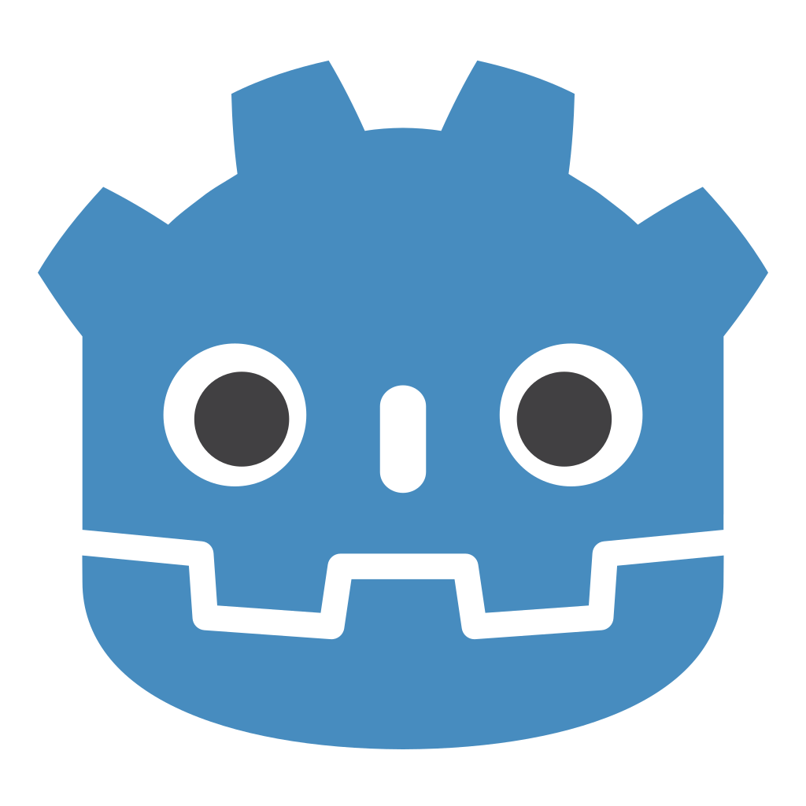
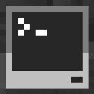
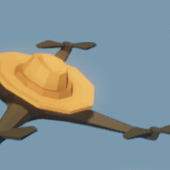

  

  
  
  
  
  

Hey there! I'm a dev who's **obsessed with speed, efficiency, and reliability**. My main playground is **Shopify, React, and Next.js**: I build e-commerce stores, develop Shopify apps (the ones merchants actually want), migrate projects to Shopify and maintain TypeScript React/Next.js repos. I also build CLIs and scripts that launch entire workflows with one command, because clicking 5 times is 4 times too many.

🚀 **Currently leveling up in:** Juggling 3 jobs, upgrading myself with AI, destroying the market with Shopify app development and discovering e-commerce secrets.  
💡 **Always striving for:** Faster workflows, better solutions, smoother collaborations and becoming the best dev I can be.

Help contribute and offer me a challenge, let's build the best superhuman in the field!

---

### 🧰 Languages and Tools

  

  &nbsp;
  &nbsp;
  &nbsp;
  &nbsp;
  &nbsp;
  

---

### 📊 Stats

  <a href="https://github.com/eyyMinda">
    <picture>
      <source media="(prefers-color-scheme: light)" srcset="https://github-stats-extended.vercel.app/api?username=eyyMinda&custom_title=Github%20Stats&show_icons=true&include_all_commits=true&theme=default&hide_border=true" />
      
    </picture>
  </a>
  <a href="https://wakatime.com/@eyyMinda">
    <picture>
      <source media="(prefers-color-scheme: light)" srcset="https://github-stats-extended.vercel.app/api/wakatime?username=eyyMinda&layout=compact&langs_count=8&theme=default&hide_border=true" />
      
    </picture>
  </a>

  <picture>
    <source media="(prefers-color-scheme: light)" srcset="https://streak-stats.demolab.com?user=eyyMinda&theme=default&hide_border=true" />
    
  </picture>

---

### 📚 Repositories

| Shopify Apps & Extensions | Full-Stack Web |
| :--- | :--- |
| **Checkout Kit**  Customizable checkout blocks, upsells & free gifts · live on <a href="https://nara.health">NaraHealth</a> | <a href="https://github.com/eyyMinda/KeyAway">**KeyAway**</a> Free CD-key giveaways with an admin dashboard · <a href="https://www.keyaway.app">🔗 live</a> `Next.js, Sanity, NextAuth, Tailwind` |
| **MindaVault Video Storage**  Host long videos beyond Shopify's file limits · live on <a href="https://trysculptique.com/">Sculptique</a> | <a href="https://github.com/eyyMinda/Blogs-Project">**Blogs-Project**</a> Markdown blog with authentication `Next.js, NextAuth, MongoDB, Tailwind` |
| <a href="https://github.com/eyyMinda/AmbShop-Order-Requests">**AmbShop-Order-Requests**</a> Storefront order requests with email notifications `React Router, Prisma, Resend, TS` | <a href="https://github.com/eyyMinda/AB-Analytics">**AB-Analytics**</a> A/B testing built on Google Analytics data `Express, Google Analytics, Tailwind` |
| ➕ 20+ private client apps, checkout extensions & Liquid themes |  |

| Coding Games | Hiring Tasks | Challenges | Game Dev | Game Tools/Mods |
| :--- | :--- | :--- | :--- | :--- |
| <a href="https://github.com/eyyMinda/BitBurner">**BitBurner**</a> `Netscript, Javascript` | <a href="https://github.com/eyyMinda/ratepunk-task-fe">**RatePunk**</a> `React, NextJs, SCSS` | <a href="https://github.com/eyyMinda/AdventOfCode">**AdventOfCode**</a> `Javascript, NodeJs` | <a href="https://github.com/eyyMinda/GameJamFPS">**GameJamFPS**</a> `Godot, GDScript, Blender` | <a href="https://github.com/eyyMinda/SteamRouteTool">**SteamRouteTool**</a> `C#` |
| <a href="https://github.com/eyyMinda/ComputerCraftSolo">**ComputerCraft**</a> `Lua` | <a href="https://github.com/eyyMinda/kandy-task-fe">**Kandy**</a> `HTML, CSS, JS` | <a href="https://github.com/eyyMinda/KataVault">**KataVault**</a> `Javascript, Typescript, Jest` | | <a href="https://github.com/eyyMinda/DirtAutopilot">**DirtAutopilot**</a> `Godot, GDScript` |
| <a href="https://github.com/eyyMinda/FarmerReplaced">**FarmerReplaced**</a> `Python` | <a href="https://github.com/eyyMinda/Pulsetto-Task">**Pulsetto**</a> `HTML, CSS, JS` | | | |

